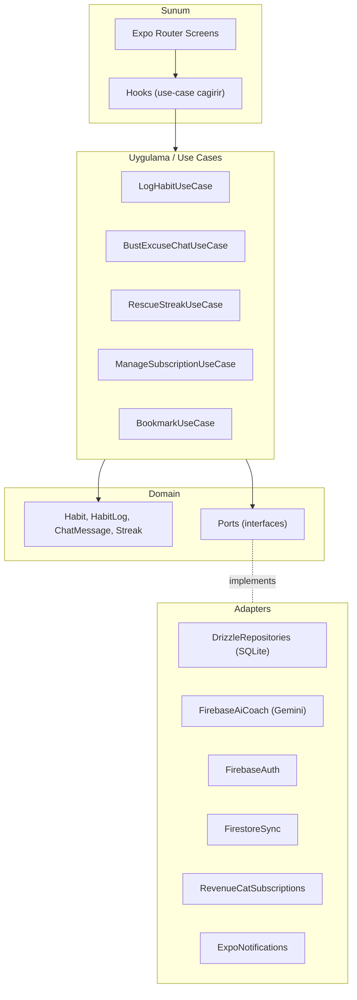
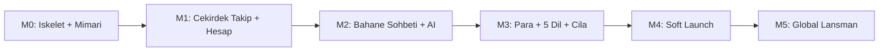

# MindAlign - Ürün Gereksinim Dokümanı (PRD)

> Akıllı Alışkanlık Takipçisi ve "Bariyer / Bahane Çürütücü" Zihinsel Kalkan
> Sürüm: 1.4 (MVP) · Tarih: Temmuz 2026 · Hazırlayan: AI Eş-Kurucu (Cursor)
> Durum: Onay bekliyor

> **Sürüm 1.4 değişiklikleri (FAZ 18 — emulator QA UX polish):**
> - **11 maddelik kullanıcı geri bildirimi kapatıldı:** onboarding yeniden oynatma, liquid glass variant'ları, profil yenileme, habit detay (timer + notlar), genişletilmiş create form, done kutlama animasyonu, koç ikon aksiyonları, rescue → habit hub, chat oturum kalıcılığı, multi-turn koç sohbeti.
> - **Tasarım:** `GlassCard` variant'ları (`subtle` / `elevated` / `accent`); core ekranlara cam dili; Reanimated micro-interactions (bkz. ADR 007).
> - **Kalan backlog:** Emulator/cihaz manuel QA imzası (`docs/faz18-manual-qa-checklist.md`); FAZ 8 store lansmanı (T-154+).

> **Sürüm 1.3 değişiklikleri:**
> - **Paket yöneticisi pnpm** olarak belirlendi (`pnpm-workspace.yaml` -> `nodeLinker: hoisted`; RN native modül uyumu, disk/hız avantajı). EAS Build pnpm'i otomatik destekler.

> **Sürüm 1.2 değişiklikleri (son geri bildirim):**
> - **Lansman 5 dil, uygulama 12 dili destekler** (i18n altyapısı 12 dile hazır).
> - **Ödüllü reklam lansmandan itibaren** (MVP'ye alındı); free kota mekaniğinin parçası.
> - **Free AI kotası 3/hafta** + kalanı ödüllü reklamla uzatma.
> - **Soft launch kararı bağlandı:** küçük pazar yok; zorunlu kapalı beta ile stabilizasyon → **global eş zamanlı** lansman.
> - **iOS test gerçeği:** kişisel iOS cihaz yok → Android-öncelikli geliştirme + iOS'u EAS Build + TestFlight (cihazlı testçi) ile doğrulama.
> - Uygulama adı (MindAlign) **geçici**; aday isimler eklendi.
> - RTL gereksiz vurgusu kaldırıldı (Arapça metin yönü sessiz teknik detay).

> **Sürüm 1.1 değişiklikleri (Soru-Yanıt dokümanı ve kullanıcı geri bildirimine göre):**
> - Lansman dili **5'e düşürüldü**: İngilizce, Türkçe, Arapça, Japonca, Fransızca.
> - **Hesap sistemi MVP'ye alındı** (Firebase Auth + misafir mod) → bookmark, sohbet geçmişi, sync.
> - **Bahane Odası artık bir sohbet (chat)** + alışkanlık bazlı notlar + bookmark/regenerate.
> - **Reklam modeli:** yalnız ödüllü (rewarded), lansman sonrası; "5$ reklamsız" katmanı iptal.
> - **Zen Odası = SADECE nefes egzersizi** (ses içeriği tamamen çıkarıldı, telif riski sıfır).
> - **AI modeli netleşti** (Gemini 3 Flash + 3.1 Flash-Lite) + token limitleri tanımlandı.
> - **Onboarding sonrası soft paywall** + genişletilmiş onboarding (kimlik hedefi, ton, bariyer, bildirim tercihleri).
> - **Fiyat:** 9.99$/59.99$ liste + 4.99$/29.99$ lansman + bölgesel.
> - **Platform:** SDK 56 (en güncel), iPhone 7 desteklenmiyor; geliştirme ortamı **Windows 11** (EAS Build ile iOS).
> - **Tasarım:** tüm cihazlarda tutarlı liquid-glass = `expo-blur` (BlurView) + NativeWind; `expo-glass-effect` iOS 26'da opsiyonel üst kat. Fildişi light mod.
> - Sesli özellik: MVP'de cihaz-içi TTS, faz 2'de Gemini Live.
> - İslami içerik: yalnız Kur'an/Sünnet/Sünnetullah + hallüsinasyon önlemi.

---

## 0. Bu Dokümanı Nasıl Okumalı

Bu doküman, fikrini Haziran 2026 gerçekliğine göre uçtan uca (kodlama -> store yayını -> ilk aboneler) gidebileceğimiz somut bir plana dönüştürür. Karar verdiğim yerlerde gerekçesini yazdım. Detaylı tartışmalar için bkz. [MindAlign_Sorular_ve_Yanitlar.md](MindAlign_Sorular_ve_Yanitlar.md).

İçindekiler:
1. Yönetici Özeti
2. Prompt Değerlendirmesi
3. Vizyon, Hedef Kitle, Persona
4. MVP Kapsamı
5. Özellikler (ekran ekran)
6. Yapay Zeka Tasarımı (model, limit, guardrail, içerik politikası)
7. Çok Dillilik (5 dil lansman / 12 dil destek)
8. Teknoloji Yığını + Geliştirme Ortamı (Windows 11)
9. Mimari (Hexagonal / Ports & Adapters)
10. Veri Modeli
11. Tasarım Sistemi (liquid-glass, fildişi, dark/light)
12. Monetizasyon (freemium + abonelik + ödüllü reklam)
13. Maliyet Analizi
14. Pazara Çıkış & ASO & Lansman
15. Yasal, Gizlilik ve Store Uyumu
16. Riskler ve Önlemler
17. Yol Haritası
18. Başarı Metrikleri (KPI)
19. Açık Sorular

---

## 1. Yönetici Özeti

**MindAlign**, sıradan bir alışkanlık takipçisi değil; kullanıcı bir alışkanlığı yapamadığında devreye giren bir **"bahane çürütücü" AI koçu** ile farklılaşan, **local-first** (önce cihaz) bir mobil uygulamadır. Temel içgörü: insanlar alışkanlıkları motivasyon eksikliğinden değil, **bahaneye/bariyere takıldıkları an** bırakır. MindAlign tam o anda araya girer, kullanıcının seçtiği zihinsel mercek (Manevi/İslami, Bilimsel/Seküler, Evrensel Sükunet) üzerinden bahaneyi bir **sohbet** içinde analiz eder ve zinciri kurtaracak **5-10 dakikalık mikro-görev** üretir.

- **Platform:** Expo (React Native) SDK 56, iOS + Android (Web faz-2). iPhone 7 ve eski cihazlar desteklenmez.
- **LLM:** Gemini ailesi - çekirdek **Gemini 3 Flash**, ön-sınıflandırıcı/kısa işler **Gemini 3.1 Flash-Lite** - **Firebase AI Logic** güvenli proxy ile (API anahtarı asla cihazda değil).
- **Mimari:** Hexagonal (Ports & Adapters), %100 SOLID, tam tip güvenli (TypeScript + Drizzle ORM).
- **Hesap:** Firebase Auth (Apple/Google/e-posta) + "misafir devam et"; bookmark ve sohbet geçmişi için sync.
- **Monetizasyon:** Freemium + abonelik (RevenueCat) + ödüllü reklam (lansmandan itibaren).
- **Pazar:** 5 dilde lansman (en, tr, ar, ja, fr), uygulama **12 dili destekler**; AI 100+ dilde yanıt verir.
- **Maliyet hedefi:** Aylık sabit altyapı ~0$ (free tier), değişken AI maliyeti kullanıcı başına ~birkaç sent.

---

## 2. Prompt Değerlendirmesi

### 2.1. Çok Güçlü Yönler (korunuyor)
- **Net farklılaştırıcı (moat):** "Bahane çürütücü + mikro-kurtarma görevi" pazarda boş bir alan. Habit app'lerin çoğu sadece "işaretleme" yapar; bu, kullanıcı **düştüğü an** değer üretir.
- **Çok-mercekli yaklaşım:** Aynı motor üç kitleye (dindar, bilim/CBT, genel mindfulness) hitap eder, pazarı katlar.
- **Sarı "kurtarılmış" halka:** "Ya hep ya hiç" hatasını kırar, mükemmeliyetçilik kaynaklı bırakmayı azaltır.
- **Local-first:** Maliyet, gizlilik ve hız avantajı; manevi/kişisel içerik için gizlilik = güven.
- **Sağlam teknik temel:** Expo Router, Expo SQLite, NativeWind, TypeScript - Haziran 2026 için güncel.

### 2.2. Kapatılan Eksikler
- AI anahtar güvenliği (Firebase AI Logic + App Check), bildirimler, monetizasyon, maliyet/kota kontrolü, güvenlik guardrail'leri, çok dillilik, onboarding'de "neden" yakalama, ve (1.1 ile) hesap/sohbet/bookmark, reklam, model+limit netliği.

---

## 3. Vizyon, Hedef Kitle, Persona

**Vizyon:** "Disiplin, irade gücüyle değil; düştüğün anda doğru soruyu soran bir akıl ile kurulur."

**Birincil persona - "Niyetli ama tutarsız" kullanıcı (18-40):** Namaz, spor, kitap, kod, dil gibi alışkanlıklar edinmeye çalışıp 3-4 günde bırakan, kendine kızan, mikro-adımlara açık kullanıcı.

**Üç alt segment (mercek):**
1. **Maneviyat odaklı:** İbadet düzeni, nefisle mücadele (TR, AR, MENA - düşük rekabet, yüksek bağlılık).
2. **Bilim/öz-gelişim:** CBT, atomic habits, dopamin (EN, FR, JA - yüksek ödeme gücü).
3. **Genel huzur:** Mindfulness, sakinlik, stres yönetimi (evrensel).

---

## 4. MVP Kapsamı

### 4.1. MVP'ye Dahil (v1.0)
- Genişletilmiş onboarding (mercek + kimlik hedefi + ton + bariyer + ilk habit'ler + "neden" + bildirim tercihleri).
- **Hesap sistemi** (Firebase Auth: Apple/Google/e-posta + misafir mod).
- Alışkanlık CRUD + günlük takip (Yeşil/Sarı/Kırmızı) + streak skoru + takvim/heatmap.
- **Alışkanlık bazlı notlar** (AI bağlamı için).
- **Bariyer/Bahane Odası = sohbet (chat)** (AI analiz + mikro-kurtarma görevi) + **bookmark + regenerate** + "Kaydedilenler" ekranı. [Çekirdek değer]
- **Sohbet geçmişi** (yerel + Firestore sync).
- **Sükunet Odası = sadece rehberli nefes egzersizi** (ses içeriği yok).
- **Bildirimler** (kullanıcı tanımlı saat/sıklık + durum yoklaması + streak risk uyarısı).
- **Cihaz-içi sesli okuma (TTS)** - koçun cevabını dinleme (ücretsiz).
- Karanlık/Aydınlık tema (fildişi light) + liquid-glass premium tasarım.
- 5 dilde UI lansman (altyapı 12 dil) + tüm dillerde AI yanıtı.
- Freemium paywall (RevenueCat) + abonelik + **onboarding sonrası soft paywall**.
- **Ödüllü reklam (opt-in):** free haftalık kota (3) dolunca "reklam izle = +1 sohbet" (UMP/ATT izinli).
- Uygulama içi değerlendirme istemi (doğru anda).
- Yerel veri yedekleme/dışa aktarma (JSON export).
- Analytics + crash raporlama (gizlilik dostu) + Remote Config.
- Güvenlik guardrail'leri (ön-sınıflandırıcı, konu-dışı reddi, kriz tespiti, sorumluluk reddi).

### 4.2. MVP Sonrası (v1.x - v2)
- Ana ekran/kilit ekranı widget'ları + Siri/App Shortcuts ("Takıldım") - featuring kozu, faz 1.5.
- **Gemini Live sesli koç** (premium, iki yönlü konuşma).
- Haftalık AI içgörü özeti (premium).
- Diğer diller (id, ur, hi, es, pt-BR, de, zh, ru...).
- Web sürümü, sosyal/hesap verebilirlik, Apple Health/Google Fit.
- İslami modda doğrulanmış kaynak (RAG) külliyatı.

### 4.3. Bilinçli Olarak MVP DIŞI
Gamification rozetleri, çoklu profil, topluluk. (Not: hesap sistemi ve sohbet arşivi artık MVP'ye **alındı**.)

---

## 5. Özellikler (Ekran Ekran)

### A. Onboarding (`/onboarding`)
Aşamalı, kısa ama derin akış (bkz. Soru 7):
- Değer önerisi -> **mercek seçimi** (kimlik değil, ton tercihi olarak sunulur; varsayılan Evrensel; bkz. Soru 1) -> **kimlik hedefi** ("nasıl biri olmak istiyorsun?") -> **ilk 1-3 alışkanlık + her biri için "neden"** -> **en sık takıldığın bariyer** -> **ton tercihi** (nazik/dürüst) -> **bildirim tercihleri** (hangi saat aralığı / günde kaç yoklama) -> bildirim izni -> hesap (misafir devam edilebilir).
- Sonunda **soft paywall** (7 gün deneme öne çıkar + "şimdilik ücretsiz devam et").
- Toplanan profil AI sistem talimatına kalıcı bağlam olarak enjekte edilir.

### B. Dashboard (`/(tabs)/index`)
- Alışkanlık kartları; son 7 gün renk halkalarıyla (Yeşil/Sarı/Kırmızı/boş).
- Karta dokun -> **alışkanlık detay** (`/habit/[id]`: düzenle, sil, streak özeti, opsiyonel odak timer, habit notları).
- "Yaptım" / "Yapamadım (Bariyere takıldım)" aksiyonları kart üzerinde.
- "Yaptım" -> **streak'e göre dinamik kutlama animasyonu** (confetti/pulse + haptic) + streak +1.
- "Yapamadım" -> Bariyer Sohbeti açılır.
- **Belirgin, kalıcı "Şu an takıldım" butonu** (habit seçmeden de sohbete girilebilir; bkz. Soru 5).
- Üstte toplam streak skoru + bugünün ilerlemesi.
- **Yeni alışkanlık:** hatırlatma, sıklık, aksan rengi alanları (genişletilmiş form).

### B2. Alışkanlık Detay (`/habit/[id]`) — FAZ 18
- Başlık/açıklama düzenleme, soft delete (arşiv).
- 7 günlük heatmap + streak özeti.
- Opsiyonel **odak timer** (countdown; arka plan davranışı ADR 009).
- **Habit notları** (SQLite journal): liste + ekle/sil.

### B3. Profil (`/(tabs)/profile`) — FAZ 18
- Liquid glass kartlar: avatar, streak/identity/approach özeti.
- Ayarlar kısayolları; **onboarding'i yeniden oynat** (QA/demo).

### C. Bariyer / Bahane Sohbeti (`/excuse/[habitId]`, `/(tabs)/chat`) - ÇEKİRDEK
- **İki giriş:** genel ("şu an zorlanıyorum") veya alışkanlığa özel (habit bağlamı taşınır).
- Çok-turlu **sohbet**: kullanıcı bahanesini/durumunu yazar; AI seçili merceğe göre, **yargılamadan**, bahanenin altındaki bariyeri isimlendirir.
- **AI'ın bağlamı:** sistem talimatı + kullanıcı profili + seçili habit + habit geçmişi (geçmiş bariyer örüntüleri) + **kullanıcının habit notları** + sohbet geçmişi.
- AI **5-10 dakikalık mikro-kurtarma görevi** üretir.
- "Mikro-görevi yaptım" -> gün **Sarı (Kurtarılmış)**, zincir kırılmaz; **habit detay ekranına yönlendirme** (sohbet SQLite'da kalır). "Vazgeçtim" -> Kırmızı + suçlamayan kapanış.
- Her AI baloncuğunda **Bookmark / Regenerate / Report — yalnızca ikon** + `accessibilityLabel` (metin buton yok).
- **Global koç sekmesi:** oturum üst barı (X kapat, "Yeni sohbet"); tab geçişinde thread korunur; explicit reset yalnızca "Yeni sohbet".
- **Multi-turn:** koç yanıtından sonra kullanıcı serbest metinle devam edebilir (kriz modu hariç).
- Streaming yanıt + opsiyonel **cihaz-içi TTS ile sesli dinleme**.

### D. Kaydedilenler (`/saved`)
- Bookmark'lanan AI cevapları (örn. "gününü kurtaran tarif"). Yerel + Firestore sync.

### E. Sükunet Odası (`/(tabs)/zen`)
- **SADECE rehberli nefes egzersizi** (4-7-8 / kutu nefes) - görsel animasyon + opsiyonel haptik. **Ses içeriği yok** (telif riski sıfır, bkz. Soru 14/8).

### F. Bildirimler
- Onboarding'de alınan tercihlere göre: **kullanıcının seçtiği saat aralığında / sıklıkta** "ne durumdasın?" yoklaması.
- Habit saatinde hatırlatma + "Direnç mi var? Konuşalım" derin-linki.
- Streak risk uyarısı (gün bitmeden).

### G. Ayarlar
- Mercek, dil, tema, bildirim tercihleri, hesap/abonelik, veri dışa aktar/sil, gizlilik, sorumluluk reddi.

---

## 6. Yapay Zeka Tasarımı

### 6.1. Model Seçimi (netleşti)
Haziran 2026 fiyatları (Gemini Developer API, paid tier, 1M token):
- **Gemini 3 Flash** - 0.50$ giriş / 3.00$ çıkış -> **çekirdek (bahane sohbeti + mikro-görev).** Empati/nüans/çok dil/yapısal çıktı için doğru denge.
- **Gemini 3.1 Flash-Lite** - 0.25$ giriş / 1.50$ çıkış -> **ön-sınıflandırıcı + kısa işler** (konu içi/dışı tespiti, başlık/etiket).
- **Gemini 3.5 Flash** - 1.50$ giriş / 9.00$ çıkış -> yalnız gerekirse (Remote Config ile yükseltilebilir).

Model adı, sıcaklık ve limitler **Firebase Remote Config**'te -> uygulama güncellemesi olmadan değişir / A-B test edilir.

### 6.2. Token Limitleri (maliyet + kalite)
- **Ön-sınıflandırıcı:** `max_output ~32-64` (sadece etiket/JSON).
- **Bahane sohbeti / mikro-görev:** `max_output ~300-384`.
- **Sohbet turu:** ~300; uzun geçmiş **özetlenir/sıkıştırılır**.
- Sistem promptu **context caching** ile (~%90 indirim).
- Başlangıç değerleri; `ai_usage` tablosu + Analytics ile ölçülüp A-B ile optimize edilir (bkz. Soru 16).

### 6.3. Mercek Bazlı Sistem Promptları
Her mercek için `system instruction` (ortak çekirdek + mercek katmanı):
- **Manevi (İslami):** nefis, vesvese, tevekkül, tövbe, zikir; şefkatli/ümitvar; **fetva vermez**. İçerik politikası: bkz. 6.5.
- **Bilimsel (CBT/seküler):** bilişsel çarpıtmalar, rasyonalizasyon, dopamin; kanıta dayalı.
- **Evrensel:** farkındalık, irade, öz-şefkat; dinden bağımsız.
Ortak: yargılama yok, daima 5-10 dk mikro-görev, kullanıcının dilinde yanıt, guardrail'lere uy.

### 6.4. Güvenlik Guardrail'leri + Kötüye Kullanım Önleme
- **Sertleştirilmiş sistem talimatı + talimat hiyerarşisi:** sadece alışkanlık/bahane/motivasyon/iyi oluş konuşur; kod/genel bilgi/ödev vb. -> nazikçe reddet, göreve döndür.
- **Güven sınırı:** kullanıcı metni delimiter ile **veri** olarak sarılır.
- **Yapısal çıktı (JSON schema):** `{ barrier_label, reflection, micro_task, encouragement }` - şema dışı çıktı reddedilir (en güçlü kalkan).
- **Ucuz ön-sınıflandırıcı (Flash-Lite):** konu-dışı/kriz/abuse tespiti -> pahalı çağrı hiç yapılmaz (güvenlik + maliyet).
- **Premium dahil adil-kullanım tavanı:** günlük yüksek ama var olan limit (maliyet bombası önleme).
- **Kriz tespiti:** öz-zarar/intihar sinyali -> koçluk yok; şefkatli mesaj + bölgesel yardım kaynağı.
- **Tıbbi sınır:** teşhis/tedavi yok, profesyonele yönlendir.
- Gemini `safety_settings` + App Check + kota + anomali logu.

### 6.5. İslami İçerik Politikası (Manevi mod)
- Kaynak yalnızca **Kur'an, sahih Sünnet, Sünnetullah.** Fetva/mezhepsel hüküm/siyaset yok.
- **Hallüsinasyon riski (uydurma ayet/hadis) kritik:** MVP'de model İslami **kavram ve ruh** üzerinden konuşur, **birebir ayet/hadis metni + referans uydurmaktan kaçınır.**
- **Faz 2:** doğrulanmış küçük külliyat (güvenilir meal + sahih hadis) ile **RAG** -> alıntılar uydurulmaz, getirilir.
- Nazik sorumluluk notu ("manevi motivasyon; fetva/dini danışmanlık değildir; bir alime danış").

---

## 7. Çok Dillilik (5 Dil Lansman / 12 Dil Destek)

**Strateji:** i18n altyapısı **12 dili** destekleyecek şekilde kurulur; pazarlama/ASO odağı ve ilk store listing'leri ise **5 dil** ile başlar. Böylece sonradan dil eklemek sadece çeviri dosyası eklemek olur (mimari değişiklik gerekmez).

**Lansman dilleri (5, ASO odaklı):**
1. İngilizce (en) - global taban
2. Türkçe (tr) - ana pazar, düşük rekabet
3. Arapça (ar) - geniş İslami pazar
4. Japonca (ja) - yüksek ödeme gücü, öz-disiplin kültürü
5. Fransızca (fr) - yüksek ödeme gücü + Fransofon erişim

**Desteklenen 12 dil (UI hazır):** yukarıdaki 5 + Endonezce, Urduca, Hintçe, İspanyolca, Portekizce (pt-BR), Almanca, Çince (zh-Hans).
*Not:* Çin anakara dağıtımı regülasyon (ICP) nedeniyle ayrı değerlendirilir; zh-Hans öncelikle anakara dışı pazarlar için.

**Önemli ayrımlar:**
- **AI yanıtları:** Gemini 100+ dili native destekler -> kullanıcı kendi dilinde yazar/cevap alır (dil listesiyle sınırlı değil).
- **UI:** `expo-localization` + `react-i18next`; metin yönü (Arapça dahil) framework tarafından otomatik ele alınır.
- **Font:** Latin + Arapça + Japonca (CJK) fallback.
- **ASO:** her lansman dili için ayrı, yerel store listing (bütçesiz büyümenin kaldıracı).

---

## 8. Teknoloji Yığını + Geliştirme Ortamı

| Katman | Teknoloji | Sürüm/Not |
|---|---|---|
| Paket yöneticisi | **pnpm** | `nodeLinker: hoisted` (RN uyumu); disk/hız avantajı; EAS uyumlu |
| Framework | Expo (React Native) | **SDK 56** (RN 0.85, React 19.2). Min iOS 16.4 / Android 7+. iPhone 7 desteklenmez. |
| Yönlendirme | Expo Router | v56 (file-based) |
| Dil | TypeScript | strict |
| Stil | NativeWind | Tailwind for RN |
| Cam efekti | **expo-blur (BlurView)** | tüm cihazlarda frosted-glass |
| Liquid Glass (ops.) | expo-glass-effect | yalnız iOS 26+, runtime guard'lı üst kat |
| Yerel DB | Expo SQLite + **Drizzle ORM** | tip güvenli, live query, migration |
| Hesap | **Firebase Auth** | Apple/Google/e-posta + misafir |
| Bulut veri | **Firestore** | bookmark + sohbet geçmişi sync |
| AI erişimi | **Firebase AI Logic** (`@react-native-firebase/ai`) | Gemini proxy, anahtar sunucuda |
| Abuse koruması | **Firebase App Check** | Play Integrity + App Attest |
| Uzaktan config | Firebase Remote Config | model/limit/kota/flag, A-B |
| Abonelik | **RevenueCat** (`react-native-purchases` + `-ui`) | paywall, bölgesel fiyat |
| Reklam (lansman) | `react-native-google-mobile-ads` | yalnız ödüllü; UMP/ATT |
| Sesli okuma | **expo-speech** | cihaz-içi TTS (ücretsiz) |
| Bildirimler | `expo-notifications` | hatırlatma + yoklama |
| i18n | `expo-localization` + `react-i18next` | 12 dil destek (5 lansman) |
| Analytics/Crash | Firebase Analytics + Crashlytics | - |
| Build/Dağıtım | EAS Build + EAS Submit + EAS Update | OTA |

**Neden Firebase (BaaS), custom backend değil:** Local-first olduğumuz için sunucunun tek kritik işi Gemini'yi güvenli proxy'lemek + abuse engellemek. Firebase AI Logic bunu **sunucu kodu yazmadan** yapar (anahtar Google'da, App Check ile cihaz doğrulaması, per-user rate limit, Remote Config). Hesap/sync gelince Auth + Firestore aynı çatıda. Lock-in, hexagonal `AiCoachPort`/`AuthPort` ile izole. (Detay: Soru 2.)

**Geliştirme ortamı (Windows 11, bütçe kısıtlı):**
- **Android = birincil geliştirme/test platformu:** Windows'ta tam döngü (emulator + cihaz). Günlük iterasyon burada.
- **iOS build:** Mac yok -> yerel Xcode/Simulator yok. **EAS Build (bulut macOS)** ile IPA üretimi + **EAS Submit** ile App Store gönderimi - **Mac gerektirmez.** İmzalama/sertifikalar EAS'te.
- **iOS testi (gerçek kısıt):** Kişisel iOS cihaz yok (iPhone 7 uyumsuz, yeni cihaza bütçe yok, Simulator yok) -> iOS'u doğrudan kendin test edemezsin. Çözüm: iOS'u **EAS Build + TestFlight** ile, **modern iPhone'u olan en az 1 testçi** (arkadaş/aile/beta testçi) üzerinden doğrula. Kod cross-platform yazılır; iOS'a özgü cila TestFlight geri bildirimiyle yapılır.
- **Risk notu:** Sınırlı doğrudan iOS testi -> önce Android'i mükemmelleştir, iOS'u beta testçilerle yakından izle; ileride imkân olursa ucuz ikinci el iOS cihaz veya bulut cihaz servisi.

---

## 9. Mimari (Hexagonal / Ports & Adapters, %100 SOLID)

Domain çekirdeği framework ve sağlayıcılardan izole; dış dünya (SQLite, Gemini, RevenueCat, Auth, Firestore, bildirim) **adapter** olarak takılır (Dependency Inversion).



**Ports:** `HabitRepository`, `HabitLogRepository`, `HabitNoteRepository`, `ChatRepository`, `BookmarkRepository`, `AiCoachPort`, `AuthPort`, `SyncPort`, `SubscriptionPort`, `NotificationPort`, `SettingsRepository`.

### Klasör yapısı
```text
/app                      # Expo Router (sunum)
  /_layout.tsx            # Providers: SQLite, i18n, Theme, Auth, RevenueCat, Firebase
  /onboarding.tsx
  /paywall.tsx
  /(tabs)/_layout.tsx
  /(tabs)/index.tsx       # Dashboard
  /(tabs)/zen.tsx         # Nefes egzersizi
  /excuse/[habitId].tsx   # Bahane sohbeti
  /saved.tsx              # Kaydedilenler
  /settings.tsx
/src
  /domain                 # entities + ports
  /application            # use-case'ler (saf TS)
  /infrastructure         # adapters: db, ai, auth, sync, subscriptions, notifications
  /presentation           # components/ui, hooks, theme, i18n
/drizzle                  # migration'lar
```

---

## 10. Veri Modeli (tip güvenli)

**Yerel (SQLite/Drizzle):**
- **settings:** `id`, `user_name?`, `selected_approach` (manevi|sekuler|genel), `language`, `theme`, `streak_score`, `is_premium` (cache), `onboarding_completed`, `created_at`.
- **user_profile:** `id`, `identity_goal?`, `default_tone` (nazik|durust), `common_barrier?`, `notif_window?`, `notif_frequency?`.
- **habits:** `id`, `title`, `description?`, `motivation_why?`, `icon?`, `color?`, `schedule`, `reminder_time?`, `is_active`, `sort_order`, `created_at`, `archived_at?`.
- **habit_notes:** `id`, `habit_id` (FK), `note_text`, `created_at`.
- **habit_logs:** `id`, `habit_id` (FK), `date` (YYYY-MM-DD), `status` (success|rescued|failed), `excuse_text?`, `barrier_label?`, `rescue_task_text?`, `created_at`. *(date+habit_id unique)*
- **chat_messages:** `id`, `habit_id?`, `role` (user|assistant), `content`, `created_at`. *(yerel cache)*
- **ai_usage:** `id`, `date`, `feature`, `tokens_estimate?`, `created_at`.

**Bulut (Firestore, hesaplı kullanıcı):**
- **users:** auth bilgisi, tercihler.
- **chat_messages / bookmarks:** sohbet geçmişi + bookmark'lar (cihazlar arası sync). Gizlilik: şifreli/silinebilir, en az veri.

Drizzle: şema tek kaynaktan; TS tipleri + SQL migration otomatik; `metro.config.js`'e `.sql`; `useMigrations` başlangıçta.

---

## 11. Tasarım Sistemi (Liquid-Glass, Fildişi, Dark/Light)

**Tasarım dili:** Sakin, nefes alan, premium. Liquid-glass yüzeyler, bol boşluk, ince tipografi, az ama anlamlı mikro-animasyon (Reanimated).

**Liquid-glass yaklaşımı (tüm cihazlarda tutarlı):**
- **Taban (iOS + Android, tüm cihazlar):** `expo-blur` **BlurView** + yarı saydamlık + ince kenarlık/gölge -> gerçek frosted-glass. (NativeWind tek başına arka plan blur'u yapamaz; bkz. Soru 7.)
- **Üst kat (opsiyonel, iOS 26+):** `expo-glass-effect` native Liquid Glass, `isLiquidGlassAvailable()`/`isGlassEffectAPIAvailable()` guard'larıyla.
- **Erişilebilirlik:** `isReduceTransparencyEnabled()` açıksa opak fallback.
- Cam yalnız dar yüzeylerde (başlık, tab bar, kartlar, paywall, "Takıldım" butonu).

**Renk:**
- **Light = fildişi** arka plan (örn. `#FBF7F1`), yumuşak gölge, derin yeşil + altın aksan (manevi ruh), AA kontrast.
- **Dark = sıcak neredeyse-siyah** (örn. `#14110E`).
- Semantic token'lar: `bg`, `surface`, `text`, `success` (yeşil), `rescued` (amber), `failed` (kırmızı), `accent`. Aksan merceğe göre incelikle değişebilir.
- **Tema:** auto | light | dark.

**Bileşenler:** `GlassCard` (**variant:** `subtle` | `elevated` | `accent`), `HabitCard`, `StreakRing`, `ApproachSelector`, `ChatBubble` (ikon bookmark/regenerate/report), `CoachChatView`, `ChatSessionHeader`, `HabitDoneCelebration`, `MicroTaskCard`, `BreathingOrb`, `PaywallSheet`, `EmptyState`, `ProfileHeroCard`.

**FAZ 18 uygulama notu:** Liquid glass token'ları ve variant kuralları [ADR 007](MindAlign/docs/adr/007-liquid-glass-design.md) ile dokümante edildi. Core ekranlar (home, auth, onboarding, profil, tab header) glass sistemine taşındı. Press scale ve kart giriş animasyonları Reanimated ile; `prefers-reduced-motion` saygılı.

**Erişilebilirlik:** AA kontrast, dinamik font, >=44pt dokunma, ekran okuyucu etiketleri.

---

## 12. Monetizasyon (Freemium + Abonelik + Ödüllü Reklam)

**Model:** Freemium + auto-renewable subscription (RevenueCat). Şirket kurmadan yayın: Apple bireysel 99$/yıl, Google 25$ tek sefer.

- **Free (Tohum):** sınırsız alışkanlık takibi, **haftalık 3 AI bahane-sohbeti**, nefes egzersizi, temel istatistik, **ödüllü reklam izleyerek kotayı uzatma** (lansmandan itibaren).
- **MindAlign Plus (Premium):** sınırsız AI (adil-kullanım tavanıyla), reklamsız, tüm bookmark/sync, gelişmiş istatistik, (faz 1.5) widget + haftalık içgörü, (faz 2) sesli koç.

**Fiyat (öneri):**
- Aylık: **liste 9.99$**, lansman **4.99$**.
- Yıllık: **liste 59.99$**, lansman **29.99$** (≈2.5$/ay, öne çıkar) + **7 gün ücretsiz deneme**.
- **Bölgesel fiyatlandırma (PPP):** düşük gelirli/yüksek hacimli pazarlarda yerel düşük katman (RevenueCat).
- "İndirim" mekaniği: gerçek fiyat 4.99/29.99 + "sınırlı lansman fiyatı" iletişimi veya store introductory offer (yanıltıcı kalıcı indirimden kaçın).

**Paywall yerleşimi:**
- **Onboarding sonrası soft paywall** (deneme öne çıkar + "şimdilik ücretsiz devam et"; bkz. Soru 4).
- Free kota dolduğunda (en yüksek dönüşüm anı).
- Ayarlar.

**Reklam (lansmandan itibaren):** yalnız **ödüllü (rewarded), opt-in**, kota duvarında ("reklam izle = +1 sohbet"). Banner/interstitial **yok** (premium-sakin marka). Premium'da reklam yok. UMP/ATT izni reklamdan önce. ("5$ reklamsız free" katmanı **iptal**.)
- **Hassas-an inceliği:** Kota duvarı kullanıcının "takıldım" dediği kırılgan ana denk gelir. Mevcut sohbet yarıda kesilmez; reklam teklifi nazik dille ve bir sonraki oturum için sunulur. Reklam sıklığı/yerleşimi A/B test edilir (kötü yorum riskini düşürmek için).

---

## 13. Maliyet Analizi

**Sabit (aylık):** Firebase (AI Logic, App Check, Auth, Firestore, Remote Config, Analytics) düşük hacimde ~**0$** (yalnız Gemini token'ı). RevenueCat ~2.5K$ gelire kadar ücretsiz. EAS ücretsiz/düşük. Apple 99$/yıl + Google 25$.

**Değişken (AI - Gemini 3 Flash, kaba):**
- Bir bahane-sohbeti turu ~ 800 giriş + ~350 çıkış token.
  - Giriş: 800 x 0.50$/1M = ~0.0004$ · Çıkış: 350 x 3.00$/1M = ~0.00105$ -> **~0.0015$/tur** (caching ile düşer).
- Free 3/hafta x 4 ≈ 12/ay -> ~**0.018$/kullanıcı/ay** (ödüllü reklam geliri bu maliyeti fazlasıyla karşılar). Premium aktif ~60/ay -> ~**0.09$/kullanıcı/ay** (abonelik gelirinin yanında ihmal edilebilir; ayrıca adil-kullanım tavanı korur).
- Ön-sınıflandırıcı (Flash-Lite) maliyeti binde birkaç sent, kötüye kullanımda asıl çağrıyı engelleyip **tasarruf** sağlar.

**Sonuç:** Gelir gelmeden ~sıfır sabit maliyet; maliyet çoğunlukla ödeyen kullanıcılarda artar -> sürdürülebilir.

---

## 14. Pazara Çıkış & ASO & Lansman

Pazarlama bütçesi yok -> **organik + lansman penceresi** her şey.

### 14.1. ASO (veriye dayalı, 2026 sinyalleri)
- **İndekslenen alanlar (iOS):** Başlık (30, en yüksek ağırlık), Alt başlık (30), gizli keyword alanı (100, virgül-boşluksuz-tekil-tekrarsız), **ekran görüntüsü altyazıları (OCR, 2025'ten beri)**. Açıklama iOS'ta indekslenmez (Android'de indekslenir).
- **Niyet/semantik arama:** problem-çözüm kümeleri hedefle.
- **Çapraz-yerelleştirme:** bazı storefront'lar ikincil dil keyword alanını da indeksler -> ekstra yüzey.
- **Sıralama sinyalleri:** indirme hızı (7-30g), dönüşüm, retention, puan (4.3+) -> lansman ivmesi + yorum stratejisini besler.
- **MindAlign örnek:** Başlık `MindAlign: Alışkanlık & Koç` / `Habit & Excuse Coach`; Alt başlık "Bahaneleri yen, disiplini kur"; keyword her dilde **yerel araştırma** (çeviri değil); ilk 2 ekran görüntüsü keyword'lü altyazı.
- **Araçlar:** AppTweak/Sensor Tower/MobileAction/AppFigures (ücretli; başta ücretsiz katman + elle rakip analizi + opsiyonel küçük Apple Search Ads keyword döngüsü). Her 4-6 haftada güncelle.

### 14.2. Lansman penceresi (karar bağlandı)
**Karar: Küçük-pazar public soft launch YOK. Zorunlu kapalı beta ile stabilize et, sonra global eş zamanlı çık.**

Gerekçe (istişare sonucu): Google Play yeni bireysel hesaplar için üretimden önce **zaten ~12-20 testçi ile 14 gün kapalı test** zorunlu kılıyor; TestFlight beta da standart. Yani bir stabilizasyon/beta aşaması **mecburen** var. O halde bir storefront'un tek-seferlik "honeymoon" ivmesini küçük bir pazara harcamak mantıksız.

Plan:
1. **Kapalı beta (de-risk):** TestFlight + Play closed testing, ~20 davetli testçi, ~2 hafta. Metrikler: crash-free, onboarding tamamlanma, D1/D7, paywall dönüşümü. Düzelt-tekrarla.
2. **Global eş zamanlı lansman:** Stabilken **5 dilde aynı gün** -> indirme ivmesini tek pencerede yoğunlaştır (sıralama sinyali) + Product Hunt + organik içerik + featuring nomination.
3. **0 yorumla çıkma:** beta geri bildirimiyle cilala + lansmanda doğru anda review istemi.

*Opsiyonel orta yol (istenirse):* ~1 hafta **yalnız İngilizce** public ile başlayıp ardından diğer 4 dili açmak. Önerilmez; kapalı beta zaten stabilizasyonu sağladığı için global boost'u bölmeye gerek yok. (Küçük/niş pazar seçilmiyor.)

### 14.3. Featuring & organik
- En güncel API'ler (widget, liquid-glass), kusursuz onboarding, yüksek tasarım -> editör ilgisi; nomination'ı haftalar önce doldur.
- Niş topluluklar (r/getdisciplined, Müslüman üretkenlik grupları), Product Hunt, kısa-form içerik ("bahaneni yaz, AI çürütsün" - viral format), waitlist landing page.

### 14.4. Testçi bulma (bütçesiz)
Yakın çevre (persona uyumlu), waitlist, niş topluluklar (r/TestFlight, r/alphaandbetausers, BetaList, Indie Hackers), lansmanda ücretsiz premium teşviki. (TestFlight iOS 16+ ister.)

### 14.5. Geri besleme döngüsü
İlk abone geliri -> küçük paid test -> en iyi dönüşen dil/kanala reinvest.

---

## 15. Yasal, Gizlilik ve Store Uyumu

- **Gizlilik:** kişisel veri büyük ölçüde cihazda; hesaplı kullanıcıda sohbet/bookmark Firestore'da (şifreli, silinebilir). Privacy policy + Apple Privacy Labels + Play Data Safety. AI'a giden metin Google'a proxy'lenir -> şeffaf bildir.
- **Hesap:** misafir mod var; üçüncü taraf girişi sunulduğu için **Sign in with Apple zorunlu**.
- **Sağlık/ruh sağlığı:** "tedavi/teşhis değildir" disclaimer + kriz kaynakları.
- **Dini içerik:** kapsayıcı, saygılı dil; fetva vermeme; sadece Kur'an/Sünnet/Sünnetullah + hallüsinasyon önlemi.
- **Abonelik uyumu:** fiyat/yenileme/iptal açıkça (RevenueCat şablonları).
- **Reklam (faz 1.5):** UMP/ATT izni; çocuk/aileye uygunluk; ödüllü format.

---

## 16. Riskler ve Önlemler

- **AI yanıt kalitesi/ton (manevi hassasiyet):** prompt testi, structured output, kullanıcı 👍/👎, Remote Config ile model yükseltme.
- **İslami içerik hallüsinasyonu:** kavram-odaklı MVP + faz-2 RAG külliyat + disclaimer.
- **Maliyet/abuse:** App Check + ön-sınıflandırıcı + kota + adil-kullanım tavanı + caching.
- **Free kota reinstall sıfırlama:** anonim/auth + App Check kısmen sınırlar (MVP'de kabul edilebilir).
- **Düşük retention:** bildirim yoklamaları + sarı kurtarma + doğru zamanlı review.
- **Store reddi (sağlık/din/abonelik):** disclaimer + kriz guardrail + kapsayıcı dil + uyumlu paywall.
- **Windows'ta iOS testi:** EAS Build + modern iOS test cihazı edinme.
- **Tek kişi:** kapsamı MVP'de tut, faz faz ilerle.

---

## 17. Yol Haritası



- **M0 - Temel:** SDK 56 projesi, hexagonal iskelet, Drizzle şema/migration, tema (liquid-glass/fildişi), i18n, Firebase (Auth/AI Logic/App Check/Remote Config/Firestore) + RevenueCat provider'ları, EAS (Windows'tan iOS build doğrulaması).
- **M1 - Çekirdek takip + hesap:** genişletilmiş onboarding, hesap/misafir, habit CRUD + notlar, dashboard + streak, bildirim tercihleri/yoklama.
- **M2 - Çekirdek değer:** Bahane Sohbeti, Firebase AI Logic + Gemini 3 Flash, ön-sınıflandırıcı + guardrail + İslami içerik politikası, structured output, sarı kurtarma, bookmark/regenerate + Kaydedilenler + Firestore sync, TTS, nefes ekranı.
- **M3 - Ticarileştirme & cila:** RevenueCat paywall (onboarding sonrası soft + kota) + bölgesel fiyat + ödüllü reklam, 5 dil UI, **liquid-glass/dark-light cila (FAZ 18 tamamlandı)**, review istemi, veri export, analytics/crash.
- **M4 - Kapalı beta (stabilizasyon):** ~20 davetli testçi (TestFlight + Play closed, 14 gün), crash-free/onboarding/paywall iterasyonu, ASO varlıkları hazırlığı. (Public küçük-pazar lansmanı yok.)
- **M5 - Global lansman:** 5 dil store listing, featuring nomination, **global eş zamanlı** çıkış, Product Hunt + organik.

*(Süre tahminleri kapsam onayından sonra; tek geliştirici hızına göre.)*

---

## 18. Başarı Metrikleri (KPI)

- **Aktivasyon:** onboarding tamamlama, ilk habit + ilk işaretleme.
- **Çekirdek değer (kuzey yıldızı):** "Yapamadım" -> mikro-görev -> "kurtardım" dönüşümü.
- **Retention:** D1/D7/D30 + kurtarılan zincir oranı.
- **Monetizasyon:** onboarding-paywall dönüşümü, trial->paid, MRR, churn, LTV.
- **AI:** tur başına maliyet, 👍/👎 memnuniyeti, kota dolum oranı, konu-dışı ret oranı.
- **ASO:** dil bazlı organik indirme, store dönüşümü, yıldız ortalaması.

---

## 19. Açık Sorular ve Karara Bağlananlar

**Karara bağlananlar (bu sürümde):**
- **Free AI kotası = 3/hafta**, kalanı ödüllü reklamla uzatılır. ✓
- **Lansman = global eş zamanlı** (kapalı beta ile stabilizasyon sonrası); küçük pazar yok. ✓
- **iOS test cihazı alınmayacak** -> Android-öncelikli + EAS Build + TestFlight (cihazlı testçi). ✓
- **FAZ 18 emulator QA UX polish (11 madde)** -> kod + Jest tamam; **manuel emulator imzası** checklist'te bekliyor. ✓ (kod) / ☐ (cihaz)

**Hâlâ açık:**
1. **Uygulama adı:** "MindAlign" geçici. Aday ve kriterler aşağıda (bkz. 19.1). Senin tercihini bekliyorum.
2. **Apple/Google geliştirici hesapları henüz açık değil** -> yayın ön koşulu. Minimum zorunlu harcama: Apple **99$/yıl** + Google **25$ (tek sefer)**. (Test cihazına bütçe yok; bu iki hesap yayın için kaçınılmaz.) Ayrıca Google'ın **~20 testçi / 14 gün** kapalı test şartı planlanmalı.

### 19.1. İsim Adayları (geçici "MindAlign" yerine)
Kriterler: kısa, 5 dilde söylenebilir, store/domain müsait, marka çakışması yok, tercihen anlamlı.
- **MindAlign** (mevcut, nötr/global)
- **Azim** - kararlılık/irade (عزم); Arapça/Türkçe/Urduca/Endonezce'de güçlü çağrışım, yine de nötr.
- **Niyah / Niya** - niyet; manevi rezonans + kısa, global söylenebilir.
- **Daima** - "her zaman"; süreklilik/disiplin teması (TR/AR).
- **Momentum / Resolv / Anchor** - global, seküler, marka dostu.
- (Karar öncesi App Store/Play isim ve domain müsaitliği + marka kontrolü yapılmalı.)

---

*Sürüm 1.4 — FAZ 18 UX polish tamamlandı. Sonraki adım: FAZ 8 store lansmanı (T-154+) ve emulator QA imzası.*
